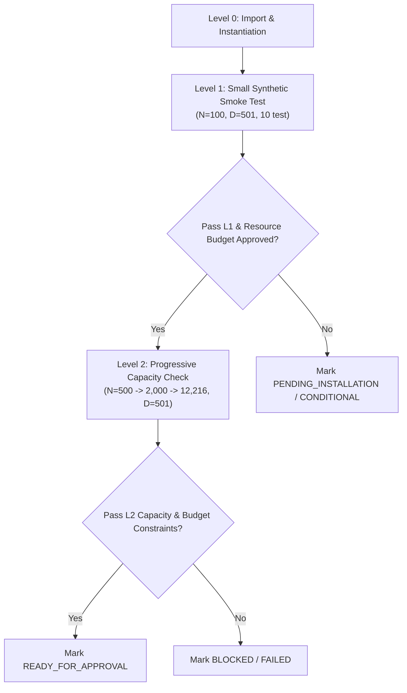

# MODEL_COMPATIBILITY_PROTOCOL.md — Multi-Tier Smoke Testing & Capacity Protocol

**Milestone:** M01 — Model Registry and Compatibility Assessment  
**Date:** 2026-11-25  
**Governing Rule:** No actual krkCMd observations or labels may be used during feasibility, smoke testing, or capacity checking.

---

## 1. Multi-Tier Testing Architecture

To rigorously evaluate the 32 model candidates without risking data leakage, contamination, or unmonitored computational crashes, a strict 3-tier progressive evaluation protocol is defined:

---

## 2. Tier Specifications

### Level 0 (L0): Import & Instantiation
- **Objective:** Verify that package binaries, C/C++ extensions, and estimator classes can be imported and initialized without DLL loading errors or symbol conflicts.
- **Verification Criteria:**
  - `import <module>` completes with exit code 0.
  - Estimator instantiates with default or specified hyperparameters without raising exceptions.

### Level 1 (L1): Small Synthetic Profile Fit & Predict
- **Objective:** Verify that the estimator natively accepts $D = 501$ numerical continuous features, completes forward/backward passes, and generates real-valued finite 1D predictions.
- **Synthetic Profile Generator Specification:**
  - Random seed: strictly deterministic (`seed = 42`).
  - Sample size: $N_{\text{train}} = 100$, $N_{\text{test}} = 20$.
  - Profile features ($D = 501$): Continuous spatial brightness signal simulating a baseline concrete surface ($I \approx 180$) overlaid with a central Gaussian absorption trough representing a concrete crack ($I \approx 30\text{--}130$), plus controlled Gaussian sensor noise ($\sigma = 3.0$).
  - Target: Synthesized crack width ($y \in [30.0, 350.0]\,\mu\text{m}$).
- **Verification Criteria:**
  - `fit(X_synth, y_synth)` completes without unhandled errors.
  - `predict(X_test)` returns an array with shape $(20,)$ or $(20, 1)$.
  - Predictions are strictly finite: `np.isfinite(y_pred).all() == True` (zero `NaN`, zero `inf`).
  - Execution duration recorded in seconds.

### Level 2 (L2): Progressive Synthetic Capacity Assessment
- **Objective:** Measure peak memory usage, CPU/GPU scaling, and execution time as sample size approaches the full krkCMd training partition size ($N = 12,216$ rows, $D = 501$ features).
- **Staging Schedule:**
  1. Stage A: $N = 500$ rows ($D = 501$)
  2. Stage B: $N = 2,000$ rows ($D = 501$)
  3. Stage C: $N = 12,216$ rows ($D = 501$)
- **Hardware Monitoring:**
  - Peak RAM delta measured via `psutil`.
  - Peak VRAM delta measured via `torch.cuda.max_memory_allocated()` or `nvidia-smi`.
  - Wall-clock fit time and prediction throughput (samples/sec).

---

## 3. Explicit Stop Conditions & Safety Bounds

To protect the host workstation (Intel Core i7, 32 GB RAM with 4.8 GB available, NVIDIA RTX 3050 4 GB VRAM, 37.5 GB free disk space), any test must immediately terminate if:

1. **Memory Ceiling:**
   - Host RAM consumption exceeds **8.0 GB** of additional memory.
   - GPU VRAM consumption exceeds **3.5 GB** (out of 4.0 GB physical VRAM).
2. **Runtime Ceiling:**
   - Single fit duration exceeds **300 seconds (5 minutes)** for classical/signal models.
   - Single fit duration exceeds **900 seconds (15 minutes)** for deep learning models.
3. **Numerical Failure:**
   - Loss divergence resulting in `NaN` or `Inf` weights or predictions.
   - CUDA out-of-memory exception.

---

## 4. Current Milestone M01 Execution Status

- **L0 & L1 Smoke Tests Executed:**
  Executed strictly for all candidates already installed in `.venv`:
  - `ML01` (Extra Trees): **PASS** (0.37s)
  - `ML02` (Random Forest): **PASS** (0.056s)
  - `ML03` (HistGradientBoosting): **PASS** (0.117s)
  - `ML07` (SVR RBF): **PASS** (0.007s)
  - `DL01` (MLP): **PASS** (0.043s)
  - `RF01` (Dummy Mean): **PASS** (0.002s)
  - `RF02` (Linear Regression): **PASS** (0.022s)
  - `RF03` (AED Python Port): **PASS** (<0.001s)
- **L2 Tests Status:**
  Deferred per project governance: L2 capacity testing on $N=12,216$ will only be executed after user approves the environment plan and computational budget.
