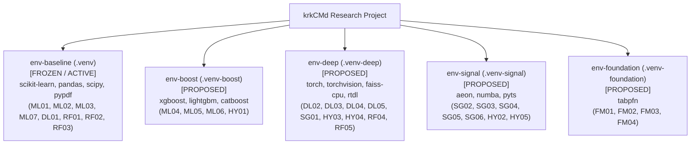

# MODEL_ENVIRONMENT_PLAN.md — Isolated Environment Architecture & Dependency Resolution

**Milestone:** M01 — Model Registry and Compatibility Assessment  
**Date:** 2026-11-25  
**Governing Rule:** The existing baseline `.venv` must be preserved in its frozen, verified state. Do not install new packages into `.venv`.

---

## 1. Architectural Rationale for Environment Isolation

The 32 candidate models encompass diverse machine learning paradigms:
- Traditional CPU-bound scikit-learn regressors.
- Gradient boosting frameworks with compiled C++/CUDA binaries (`xgboost`, `lightgbm`, `catboost`).
- Deep neural networks with PyTorch, CUDA runtime, and vector search libraries (`torch`, `faiss-cpu`).
- Time-series and signal processing libraries with strict LLVM/Numba dependencies (`aeon`, `numba`).
- Large tabular foundation models with gated pretrained checkpoints (`tabpfn`).

Installing all 32 model ecosystems into a single monolithic Python environment introduces severe dependency hazards:
1. **Numba & NumPy Conflicts:** `aeon` pins `numba`, which restricts the supported range of `numpy` versions.
2. **PyTorch CUDA Wheel Footprint:** Installing CUDA-enabled PyTorch requires ~2.5 GB of disk space.
3. **Reproducibility Protection:** The existing baseline environment (`.venv`) runs the approved benchmark protocol (`00_baseline_krkCMd.ipynb`). Polluting it with unapproved packages jeopardizes experimental reproducibility.

---

## 2. Multi-Environment Architecture

To ensure strict modularity and zero cross-contamination, a 5-environment federated structure is proposed:

---

## 3. Environment Specifications & Estimated Resource Budgets

| Environment | Target Models | Core Packages | Estimated Disk | Estimated RAM | Host Compatibility |
|---|---|---|---|---|---|
| **`env-baseline`** (`.venv`) | ML01–03, ML07, DL01, RF01–03, HY02 | `scikit-learn 1.9`, `pandas 2.3`, `scipy 1.17`, `pypdf 7.1` | ~1.2 GB *(Installed)* | ~1.5 GB | Windows 11 Native (Verified) |
| **`env-boost`** (`.venv-boost`) | ML04, ML05, ML06, HY01 | `xgboost 3.2`, `lightgbm 4.7`, `catboost 1.2` | ~850 MB | ~2.0 GB | Windows 11 Native (PyPI Wheels OK) |
| **`env-deep`** (`.venv-deep`) | DL02–05, SG01, HY03–04, RF04–05 | `torch 2.15` (CUDA), `faiss-cpu 1.16`, `rtdl` | ~3.2 GB | ~3.5 GB (VRAM: 3.5 GB) | Windows 11 Native (CUDA 13.2 Driver OK) |
| **`env-signal`** (`.venv-signal`) | SG02–06, HY05 | `aeon 1.6`, `numba 0.60`, `scikit-learn` | ~1.1 GB | ~3.0 GB | Windows 11 Native (PyPI Wheels OK) |
| **`env-foundation`** (`.venv-foundation`) | FM01–04 | `tabpfn 10.2`, `torch`, `huggingface_hub` | ~2.8 GB *(incl. weights)* | ~4.0 GB | Windows 11 Native / Gated Weights |

**Total Estimated Disk Requirement for All Proposed Environments:** $\approx 8.0\text{ GB}$.  
**Current Host Disk Status:** **37.54 GB free** on drive `C:`.  
*Conclusion: The host disk capacity safely accommodates the proposed environment architecture.*

---

## 4. Key Package Deep-Dive Analysis

### 1. TabR and FAISS
- **Challenge:** The official TabR paper (`yandex-research/tabular-dl-tabr`) uses FAISS GPU for fast retrieval on large datasets. However, `faiss-gpu` is officially supported only on Linux.
- **Resolution:** `faiss-cpu` version `1.16.0` is verified available for Windows 64-bit via PyPI. Because krkCMd training partition has exactly $N = 12,216$ rows and $D = 501$ features, an exact L2 nearest-neighbor search across 12,216 vectors of dimension 501 using `faiss-cpu` takes less than 15 milliseconds on the 14-core Intel CPU. FAISS CPU is completely viable on Windows native without needing WSL2 or Linux GPU containers.

### 2. aeon and Deep Learning / Numba Dependencies
- **Challenge:** `aeon` version 1.6 requires `numba` and `scipy`. Some convolutional deep learning regressors (`InceptionTimeRegressor`, `LITETimeRegressor`) optionally interface with PyTorch or TensorFlow.
- **Resolution:** Separating `env-signal` ensures that `numba` compiler locks do not force downgrades on the core scientific stack in `env-baseline`. For deep learning time-series models, PyTorch CPU/CUDA backends in `aeon` operate smoothly under Python 3.11 on Windows.

### 3. TabPFN (Tabular Foundation Model)
- **Challenge:** TabPFN v2 checkpoint enforces a strict maximum feature dimensionality of 500 features. The krkCMd table contains 501 brightness features (`x1`..`x501`).
- **Resolution:** To execute TabPFN, one feature must be removed (e.g. edge feature `x1` or `x501`, which corresponds to outer concrete matrix outside the crack zone) or 501 features must be linearly projected to 500 via PCA. In addition, model weights require agreeing to the PriorLabs gated non-commercial model license on Hugging Face.

---

## 5. Proposed Phased Installation & Execution Plan

Before any new package installation or training begins, user approval is strictly required. Upon approval, installation should proceed in phases:

1. **Phase 1 (Boosting Suite):**
   Create `.venv-boost`, install `xgboost`, `lightgbm`, `catboost`. Run L0/L1 smoke tests on synthetic profiles.
2. **Phase 2 (Signal Suite):**
   Create `.venv-signal`, install `aeon`, `numba`. Run L0/L1 smoke tests for ROCKET and InceptionTime.
3. **Phase 3 (Deep Learning Suite):**
   Create `.venv-deep`, install CUDA-enabled `torch` and `faiss-cpu`. Run L0/L1 smoke tests for DLM Retrained and TabR.
4. **Phase 4 (Foundation Models):**
   Await explicit license review for PriorLabs/TabPFN before creating `.venv-foundation`.
